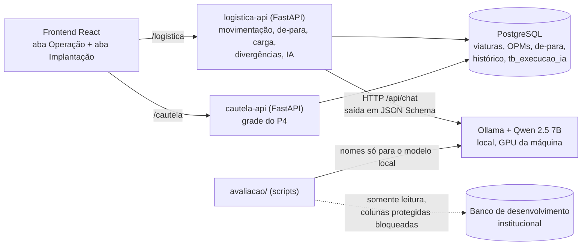
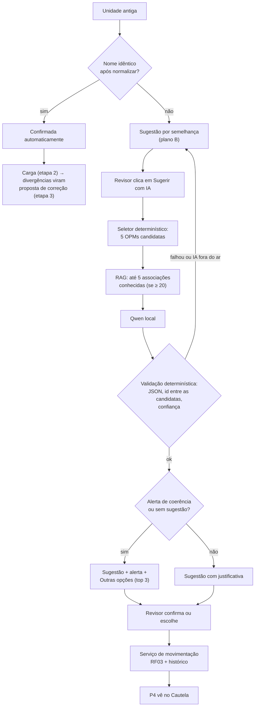

# Lotação de viaturas com IA local — documentação da apresentação

**Curso:** IA Avançada para Infraestrutura, Dados e Desenvolvimento de TI (SESP-MT) · **Projeto final (MVP)**
**Repositório:** este projeto · **Execução:** ver [`README.md`](../README.md) · **Histórico e decisões:** [`CLAUDE.md`](../CLAUDE.md)

Este documento segue os 10 requisitos obrigatórios e o roteiro mínimo de demonstração do curso. Todos
os números citados foram medidos neste projeto; os relatórios estão em [`evidencias/`](../evidencias).

---

## 1. Problema e resultado esperado (requisito 01)

**Problema.** A viatura tem duas colunas de lotação: a antiga (`cod_upm`, cadastro de unidades antigo) e
a nova (`cod_opm`, cadastro corporativo de OPMs). O **Sistema de Logística** gravava a lotação só na
coluna antiga; o **Sistema de Cautela** decide quem vê a viatura pela coluna nova. Resultado: a viatura
fica **invisível para o P4** (gestor de frota) da unidade que a usa, ou presa numa OPM extinta, sem
check-in. Os dois cadastros **não têm chave em comum**: a única ponte é o **nome** da unidade, escrito de
formas diferentes ("NPM Luciara - 7º BPM" × "NUCLEO PM - LUCIARA").

**Tamanho real** (diagnóstico somente leitura no banco de desenvolvimento, só contagens):

| Frota operacional (ativa, manutenção, reserva) | Viaturas |
|---|---:|
| Total | 2.459 |
| Com lotação quebrada | **482 (19,6%)** |
| Invisíveis no Cautela (sem `cod_opm` ou com código inexistente) | **201** |
| Em OPM não vigente (sem check-in) | 263 |
| Em OPM com vigência desconsiderada (E/C) | 18 |

**Público-alvo.** Equipe de implantação da Logística (o **revisor**, que associa unidades antigas às
OPMs) e, como beneficiário final, o **P4** de cada OPM, que passa a ver a frota correta no Cautela.

**Critérios observáveis de sucesso**

| Critério | Meta | Resultado medido |
|---|---|---|
| Nenhuma viatura ativa sem OPM após a implantação | 0 | **0** (teste `test_carga_deixa_todas_as_ativas_com_opm`; demo etapa 2) |
| Viatura aparece para o P4 logo após a confirmação | imediato | **~30 ms** (teste e2e) |
| IA sugere a OPM certa, nos dados reais (gabarito de 157 UPMs nunca usadas para ajuste) | ≥ 70% | **73,9%** (regra fixa atual: 19,7%) |
| OPM certa visível para o revisor (sugestão + opções na dúvida) | ≥ 75% | **77,7%** |
| A IA nunca confirma nem move viatura sozinha | 0 casos | **0** (por desenho; testes) |

---

## 2. Requisitos e arquitetura (requisito 02)

**Requisitos prioritários**

| ID | Requisito |
|---|---|
| RF01 | Toda escrita de lotação grava só a coluna nova (um ponto único de escrita) |
| RF02 | O Cautela mostra ao P4 as viaturas disponíveis da sua OPM, pela coluna nova |
| RF03 | OPM de destino precisa existir e estar ativa, com a mensagem oficial |
| RF04 | Implantação: associar unidade antiga → OPM, carga em lote, contingência (OPM 0) e relatório |
| IA | Sugerir a OPM de cada unidade antiga sem correspondência, com justificativa, validada, sob decisão humana |
| RNF01 | Transação explícita e rollback total |
| RNF02 | Visibilidade imediata; cadastro antigo oculto na operação |

**Componentes**

| Camada | Onde |
|---|---|
| Entrada | Tela (revisor, operador) e cadastro antigo (`tb_unidade_legado`) |
| Processamento | `logistica-api`: normalização + semelhança, seletor de candidatas, validação, movimentação |
| Recurso de IA | Qwen 2.5 7B via Ollama, local (`app/services/ia_de_para.py`) |
| Dados | PostgreSQL (fictício na demo); banco de desenvolvimento só para diagnóstico e avaliação |
| Integrações | Logística ↔ Cautela pelo mesmo banco; Logística → Ollama por HTTP |
| Saída | Lotação gravada, grade do P4 atualizada, relatórios CSV, log de execuções da IA |

**Fluxo da associação (etapa 1 da Implantação)**

**Decisões de arquitetura**

| Decisão | Motivo |
|---|---|
| Corrigir a aplicação (ponto único de escrita), não trigger nem view | Resolve na origem, valida a OPM e mantém histórico (alternativas no README) |
| **Modelo local** (Qwen via Ollama), não serviço externo | Nomes de unidades são dados institucionais: não saem da máquina; sem chave de API |
| A IA só **sugere**; só nome idêntico é automático | Erros reais de 20–30% exigem decisão humana; ação de impacto (lotar viatura) passa pelo revisor |
| Sem camada "histórico das viaturas" | No banco real, as viaturas já preenchidas vieram de scripts antigos de equiparação por descrição: não são evidência independente. Servem só como exemplos do RAG |
| Fine-tuning e MCP descartados | Poucos pares e com ruído para treinar; MCP não melhora a qualidade da sugestão |

---

## 3. Protótipo executável (requisito 03)

`docker compose up -d --build` sobe PostgreSQL, as duas APIs e a interface (http://localhost:5173), com
dados fictícios que reproduzem os padrões do banco real. O fluxo completo — problema → associação com IA
→ carga → divergências → OPM 0 → operação → P4 vê a viatura — roda pela tela (roteiro na seção 11).

---

## 4. Uso efetivo de IA (requisito 04)

**O que a IA faz.** Recebe a descrição antiga e as 5 OPMs candidatas e devolve, em JSON obrigatório,
`{id_opm, confianca, justificativa}`. Resolve o que a regra fixa não alcança: siglas (BPTRAN →
Batalhão de Trânsito), unidade superior citada após o hífen, **subida de nível** (núcleo que virou
pelotão; esquadrão que virou regimento) e grafias livres.

**Por que IA.** Sem chave entre os cadastros e com nomes muito variados, a regra fixa (normalização +
semelhança de texto) acerta **19,7%** nos dados reais. Um modelo de linguagem entende abreviações e
contexto ("NPM" = núcleo; o número depois do hífen é a superior), e o modelo **local** atende à regra de
não expor dados institucionais.

**O que é determinístico e o que é IA**

| Determinístico (código, testado) | IA (Qwen local) |
|---|---|
| Normalização e semelhança de nomes; confirmação por nome idêntico | Escolher, entre as candidatas, a mesma unidade |
| Seleção das 5 candidatas (termos raros, siglas) | Justificativa em linguagem natural |
| Recuperação dos exemplos do RAG (forma da descrição) | |
| Validação da saída, alerta de coerência, top 3 na dúvida | |
| Confirmação, lotação, histórico, carga, divergências | |

**Como a saída é validada**

1. **Contrato:** JSON Schema exigido pelo Ollama; `id_opm` precisa estar **entre as candidatas enviadas**
   (barra alucinação); confiança entre 0 e 1 e ≥ 0,6. Fora disso: descartada, vale a semelhança.
2. **Alerta de coerência:** se a cidade (ou outro termo distintivo) da descrição não está na OPM sugerida
   mas está em outra candidata, a tela avisa. Motivo: o modelo às vezes **inventa a justificativa**
   ("mesma localidade" sem ser).
3. **Top 3 na dúvida:** sem sugestão ou com alerta, o revisor vê as próximas candidatas.
4. **Decisão humana:** nada é gravado nas viaturas sem o revisor confirmar.
5. **Medição com dados reais:** gabarito de 228 unidades do banco de desenvolvimento, dividido em
   **dev** (71, para ajustar) e **teste** (157, usado só para medir); exemplos do RAG só da dev.

**Evolução medida (partição teste, 157 unidades; híbrido = nome idêntico → IA → semelhança)**

| Versão | Acertos | Erros | Sem sugestão | Acurácia | Precisão |
|---|---:|---:|---:|---:|---:|
| Regra fixa (antes da IA) | 31 | 32 | 94 | 19,7% | 49,2% |
| v1 — primeiro prompt, 20 candidatas | 69 | 39 | 49 | 43,9% | 63,9% |
| v2 — regras reescritas, 5 candidatas | 100 | 35 | 22 | 63,7% | 74,1% |
| v6 — + RAG de exemplos | 112 | 23 | 22 | 71,3% | **83,0%** |
| **v8 — + hierarquia e subida de nível (padrão)** | **116** | 30 | **11** | **73,9%** | 79,5% |

Com o top 3 na dúvida, a OPM certa fica visível para o revisor em **77,7%** dos casos. Latência:
~2,3 s por unidade numa RTX 3060 de 6 GB. Detalhes: [`ajuste_prompt`](../evidencias/ajuste_prompt_20261105.md),
[`rag_exemplos`](../evidencias/rag_exemplos_20261105.md), [`ajuste_nivel`](../evidencias/ajuste_nivel_20261105.md).

**Escolha da v8 sobre a v6:** mais acertos e metade dos casos sem sugestão, ao custo de mais erros por
sugestão (83,0% → 79,5% de precisão). Como toda sugestão passa pelo revisor, uma sugestão errada custa a
mesma busca que nenhuma — e o alerta e o top 3 ajudam a pegá-la. `IA_VERSAO_PROMPT=v6` volta à versão de
maior precisão.

---

## 5. Dados e integração (requisito 05)

| Dado | Origem e formato | Como é usado |
|---|---|---|
| Seed da demo | `db/02_seed.sql`: **fictício**, padrões reais (OPMs em maiúsculas com abreviatura, núcleos, pelotões, CR, siglas, unidade elevada, legado vazio/inexistente, divergência) | Carregado no PostgreSQL na subida; `scripts.reset_demo` recria |
| Banco de desenvolvimento | `transporte.tb_veiculo`, `geral.tb_upm`, `sgpm.opm`, `sgpm.opm_tipo_orgao` | Diagnóstico e gabarito, **somente leitura**, só agregados nos relatórios |
| Gabarito | `avaliacao/gerar_gabarito.py` → `dados_reais/*.csv` (fora do git) | Comparativo regra × IA |
| Hierarquia das OPMs | `sgpm.opm_tipo_orgao` (CR > BPM ≈ CIPM > CIA > PEL > NPM; Regimento = Batalhão, Esquadrão = Companhia) | Regras do prompt v8 |

**Integrações:** a interface fala com as duas APIs (proxy do Vite); Logística e Cautela compartilham o
banco (visibilidade imediata); a Logística chama o Ollama por HTTP (`/api/tags` para status,
`/api/chat` para sugestão), com timeout e disjuntor.

---

## 6. Testes e validação (requisito 06)

| Cenário exigido | Testes automatizados (exemplos) | Evidência na demo |
|---|---|---|
| **Funcionamento esperado** | `test_resposta_valida_vira_sugestao_aceita`, `test_ia_sugere_mas_nao_confirma_nem_move_viatura`, `test_carga_deixa_todas_as_ativas_com_opm` | Etapas 1–4 levam as viaturas ao P4 certo |
| **Entrada inválida / caso-limite** | JSON inválido, campo ausente, confiança fora da faixa, **id fora das candidatas** (alucinação), instrução embutida na descrição, OPM inativa (RF03), revisor vazio | Movimentar para OPM extinta → mensagem oficial |
| **Falha da IA** | Ollama fora do ar + **disjuntor** após 3 falhas, timeout, modelo não instalado, IA desativada | Fechar o Ollama → "IA indisponível"; semelhança continua |
| **Resposta inadequada da IA** | `test_sugestao_incoerente_ganha_alerta_mas_continua_para_o_revisor` | 107: sugestão errada com alerta + opção certa |

**Totais:** 133 testes na Logística, 6 no Cautela, 18 na avaliação (sem banco/Ollama reais: IA
simulada), mais o teste e2e de latência. Evidências com dados reais em `evidencias/` (só agregados).

---

## 7. Segurança e privacidade (requisito 07)

- **Dados:** demo 100% fictícia. O banco de desenvolvimento é lido em modo **somente leitura**, com
  bloqueio, antes de executar, de qualquer consulta a coluna protegida (placa, chassi, RENAVAM, valor,
  observações, contatos, localização, `log_*`) ou `SELECT *` — testado.
- **Nomes reais de unidades** ficam em `dados_reais/` (fora do git) e só vão ao **modelo local**.
- **Sem credenciais no código:** conexão por `DIAG_DATABASE_URL` ou `.env` externo; senhas do compose são
  fictícias e locais.
- **Limites de uso:** 5 candidatas e 5 exemplos por chamada, timeout, disjuntor após 3 falhas,
  `IA_HABILITADA` para desligar.
- **Controle humano nas ações de impacto:** a IA nunca confirma; toda lotação exige revisor identificado,
  passa pela validação do RF03 e fica no histórico; lotes são tudo ou nada; a IA não sobrescreve decisão
  humana (inclusive confirmada enquanto ela analisava).

---

## 8. Tratamento de erros e observabilidade (requisito 08)

- **Mensagens compreensíveis:** RF03 oficial; "IA indisponível (modelo): as sugestões por semelhança
  continuam valendo"; "Resposta descartada pela validação"; "⚠ Verifique: ..." (alerta de coerência).
- **Registro de execução:** `tb_execucao_ia` guarda **toda** chamada (resultado, motivo de descarte,
  latência, modelo e versão do prompt, usuário) — `GET /api/de-para/ia/execucoes`; logs da API;
  histórico de movimentação; relatório CSV de inconformidades com quem executou.
- **Diagnóstico:** `scripts/diagnostico_ia.py` mostra o que a IA recebeu e respondeu para unidades
  específicas; cada sugestão grava o modelo e a versão do prompt que a geraram.

---

## 9. Reprodutibilidade (requisito 09)

Tudo no [`README.md`](../README.md): pré-requisitos (Docker Desktop; Ollama com `qwen2.5:7b` para a IA),
`docker compose up -d --build`, `POSTGRES_PORTA_HOST` se a 5433 estiver ocupada, `scripts.reset_demo`,
testes (`pytest` com Postgres de teste), roteiro da demo com resultados esperados e os comandos da
avaliação (`avaliacao/`).

---

## 10. Limitações e próximos passos (requisito 10)

| Limitação real | Próximo passo |
|---|---|
| **O gabarito mede concordância com scripts antigos** de equiparação por descrição, não a verdade | Revisar à mão uma amostra dos erros com quem conhece o cadastro |
| **Teto do seletor:** a OPM certa está entre as 5 candidatas em ~81,5% dos casos | Seletor por embeddings locais |
| **Limites do modelo de 7B:** justificativa às vezes falsa; confiança pouco informativa (não separa erros) | Testar `qwen3:8b` (cabe em 6 GB); manter alerta e top 3 |
| **RAG depende de ≥ 20 exemplos:** na demo (4 confirmadas) fica desligado; com poucos exemplos ele piorava | Em produção há ~265 pares; monitorar o ganho conforme crescem as confirmações |
| **"Certa na tela" não é "escolhida":** o efeito no revisor não foi medido com usuários | Medir no piloto: tempo e acerto da decisão |
| **Qualidade de dados do banco real:** registros "Teste" nas tabelas de tipo de OPM, códigos órfãos, colunas sem FK | Limpeza e FKs após a implantação |
| Sem login (revisor é um nome digitado); banco compartilhado entre os sistemas; schema por SQL | SSO, Alembic e evento `viatura.movimentada` se os bancos forem separados |

---

## 11. Roteiro da demonstração (~15 min)

Antes: `docker compose up -d --build` (ou `POSTGRES_PORTA_HOST=5435 ...`), Ollama aberto,
`scripts.reset_demo`, http://localhost:5173.

| # | Roteiro do curso | O que mostrar | Tempo |
|---|---|---|---|
| 1 | Problema e público | Números reais (seção 1); na tela, 20 viaturas "invisíveis no Cautela" e o P4 da OPM 2 sem viaturas | 2 min |
| 2 | Fluxo completo com entrada real de teste | Aba Implantação: preencher Revisor → **Sugerir com IA** → mostrar sugestão, confiança, justificativa, **alerta** (107) e **outras opções** (107, 110) → confirmar as 6 → carga (7 lotadas, 4 na OPM 0, 1 divergência) → divergência JKL1S11 → P4 da OPM 2 passa a ver | 6 min |
| 3 | Onde a IA participa e o que é determinístico | Tabela da seção 4 + fluxo da seção 2 | 2 min |
| 4 | Teste de erro/falha | Fechar o Ollama → "IA indisponível" e semelhança continua; movimentar para OPM extinta → mensagem do RF03; `GET /api/de-para/ia/execucoes` | 2 min |
| 5 | Arquitetura, segurança e limitações | Seções 2, 7 e 10; evolução v1 → v8 (seção 4) | 3 min |

Resultado esperado da IA na demo (dados fictícios, RAG desligado — vale a `v8s`): 103, 106, 108 e 109
sugeridas certas; 107 sugerida errada **com alerta** e a certa como primeira das outras opções; 110 sem
sugestão, com a certa como primeira das outras opções.
